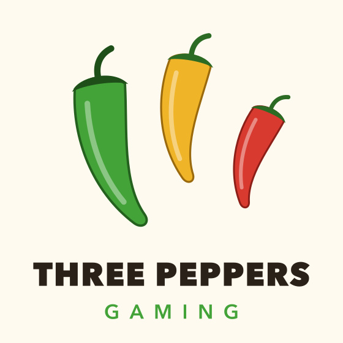
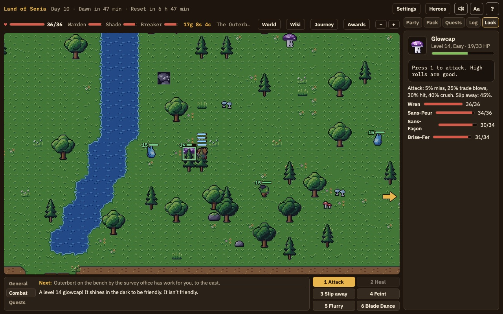
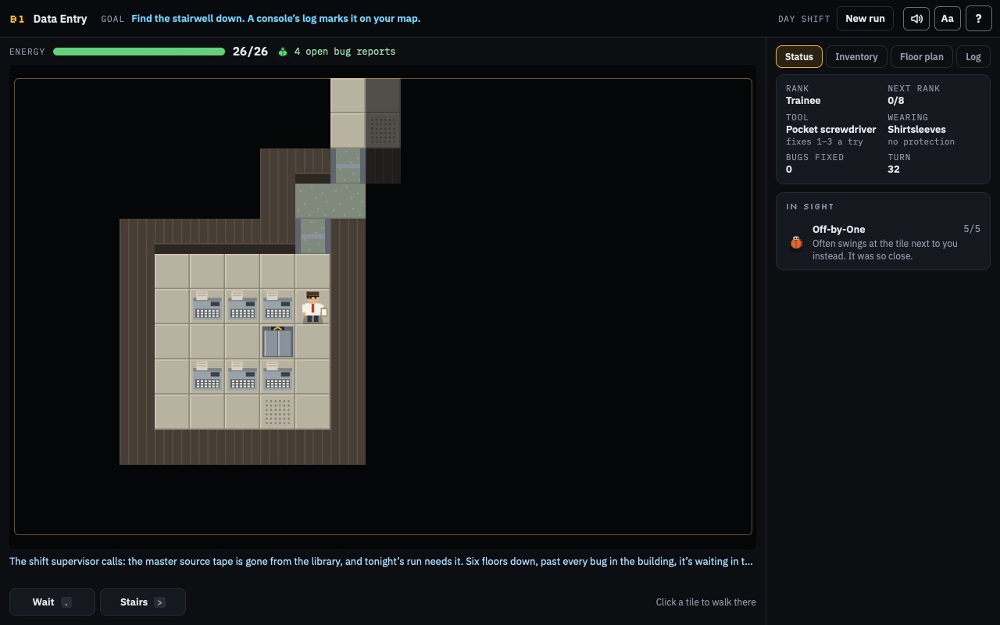
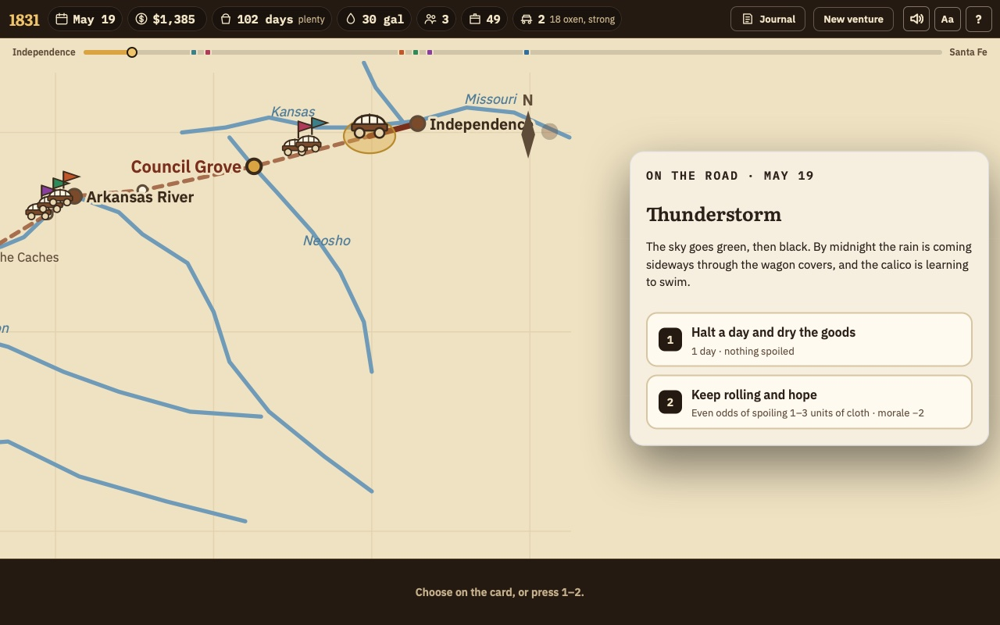
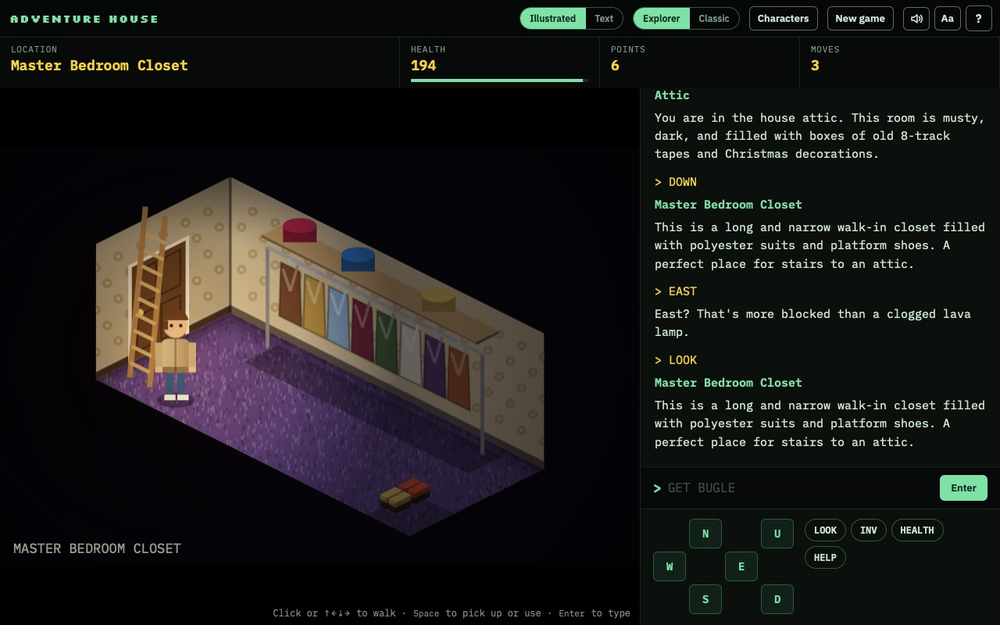
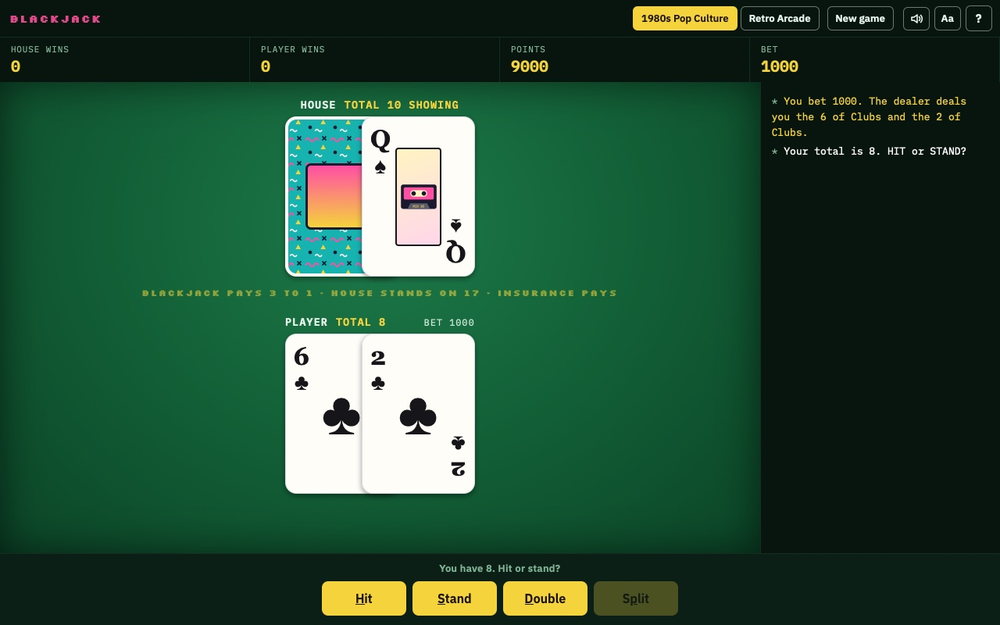
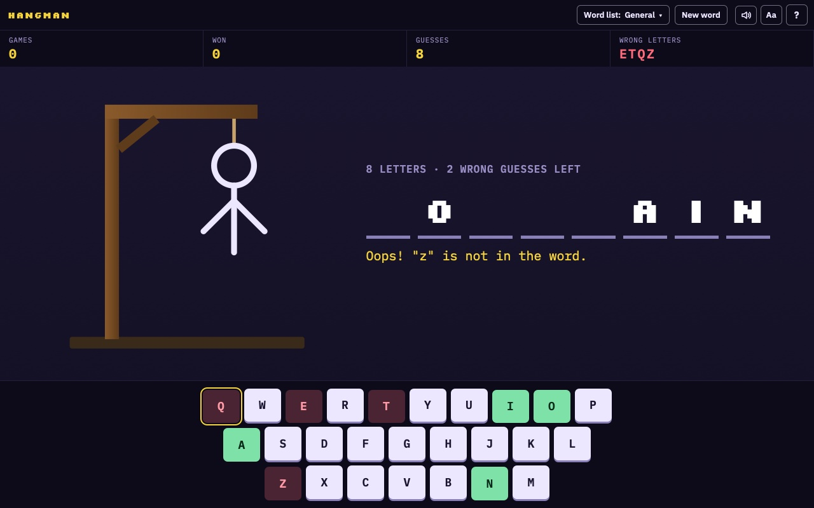

<p align="center"></p>

# The games

Free Mac games from Three Peppers Gaming. Tap and trust once, then install any of them:

```sh
brew tap pounceapps/games
brew trust pounceapps/games
```

## Land of Senia



A casual pixel RPG on a lost coast. Pick one of four callings, gather friends, fight in turns, and clear 19 bosses from the land. There's a home with pets, taverns, fishing and cards, and you can stop and pick up any time. Licensed pixel art and music. Mac only.

Install: `brew install --cask land-of-senia`

## Inside the Mainframe



A turn-based dungeon crawl set in a 1970s computer center. Go down six floors of machine rooms, fix the bugs in your way, and bring back the lost source tape.

Install: `brew install --cask inside-the-mainframe` · [Play in the browser](https://stevesparks.com/arcade/mainframe)

## Santa Fe Trader



Outfit a wagon train in Missouri, cross the plains to Santa Fe, and sell before the market fills. The weather and your choices on the road decide your profit.

Install: `brew install --cask santa-fe-trader` · [Play in the browser](https://stevesparks.com/arcade/santafe)

## Adventure House



Wake up in the attic of a strange house and find the way out. A two-word adventure you can play as text or walk room by room in an illustrated house.

Install: `brew install --cask adventure-house` · [Play in the browser](https://stevesparks.com/arcade/adventure)

## Blackjack



Single-deck blackjack on a card table: bet, hit, stand, double, split and insure, with two retro card decks.

Install: `brew install --cask blackjack` · [Play in the browser](https://stevesparks.com/arcade/blackjack)

## Hangman



Nine word lists, from first-grade words to SAT vocabulary and programmer terms. Find the word before six wrong guesses.

Install: `brew install --cask hangman` · [Play in the browser](https://stevesparks.com/arcade/hangman)

---

[Back to Three Peppers Gaming](https://github.com/Three-Peppers-Gaming)
