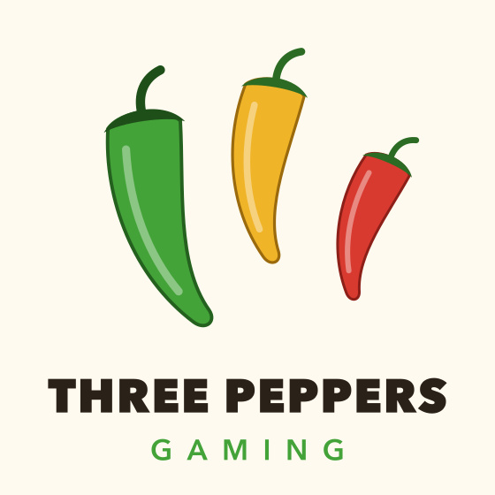

<p align="center"></p>

## Three Peppers Gaming

Small, friendly games by Steve Sparks: retro text games, card games and a cozy pixel RPG. Free, family-friendly, and made with Claude Code.

**Website: [threepeppersgaming.com](https://threepeppersgaming.com)**

## Mac games

Signed and notarized, for Apple silicon and Intel Macs with macOS 13 or later. Install with [Homebrew](https://brew.sh):

```sh
brew tap pounceapps/games
brew trust pounceapps/games
brew install --cask land-of-senia
```

| Game | What it is | Cask |
|---|---|---|
| Land of Senia | A casual pixel RPG: four callings, 19 bosses, a home with pets. Licensed art and music | `land-of-senia` |
| Inside the Mainframe | A turn-based dungeon crawl through a 1970s computer center | `inside-the-mainframe` |
| Santa Fe Trader | Run a wagon of trade goods down the Santa Fe Trail | `santa-fe-trader` |
| Super Star Trek | A free tribute to the 1978 BASIC space game | `super-star-trek` |
| Adventure House | A two-word text adventure. Escape or die! | `adventure-house` |
| Blackjack | Single-deck blackjack with retro card art | `blackjack` |
| Hangman | Hangman in the style of a 1980s bulletin board | `hangman` |

**[See the games, with screenshots →](https://github.com/Three-Peppers-Gaming/.github/blob/main/games.md)**

`brew upgrade --cask` gets new versions. Most of these also play in the browser at [stevesparks.com/arcade](https://stevesparks.com/arcade).

**Why PounceApps?** [PounceApps](https://github.com/pounceapps) is where all my Mac apps are built, signed and handed out. The games are Three Peppers Gaming; PounceApps is the shipping dock.

## Windows games

The original console games on the Microsoft Store:

- [Adventure House](https://www.microsoft.com/store/productId/9N01PKFTC7Z4)
- [Simple Text BlackJack](https://www.microsoft.com/store/productId/9N7QJXL60JKB) ([source](https://github.com/Three-Peppers-Gaming/SimpleBlackJack))
- [Simple Hangman](https://apps.microsoft.com/detail/9pnbj6064x3q)

## More game projects

Older experiments and tools, on [my own GitHub](https://github.com/StevenSSparks):

- [Simple Text Games](https://github.com/StevenSSparks/simple-text-games): the Microsoft Store console games
- [Adventure Server](https://github.com/StevenSSparks/AdventureServer): a text adventure framework inside a web API, with [a console client](https://github.com/StevenSSparks/PlayAdv) and [a Blazor client](https://github.com/StevenSSparks/PlayAdvBlazor)
- [BlackJack Server](https://github.com/StevenSSparks/BlackJackServer): blackjack as a simple web API
- [Super Star Trek](https://github.com/StevenSSparks/SuperStarTrek): the Matuszek, Reynolds and Almy classic, set up to build in Visual Studio
- [Altair 8800 on Azure Sphere](https://github.com/StevenSSparks/AzureSphereAltair8800) and [8085 Tiny BASIC](https://github.com/StevenSSparks/8080-SBC-tiny-basic): old machines, kept running

## Privacy

The games collect nothing. They save your progress on your own computer and don't send anything anywhere. Land of Senia can write a bug report file when you ask it to; it stays on your Mac unless you choose to share it.

## Developer

Made by [Steve Sparks](https://github.com/StevenSSparks).
